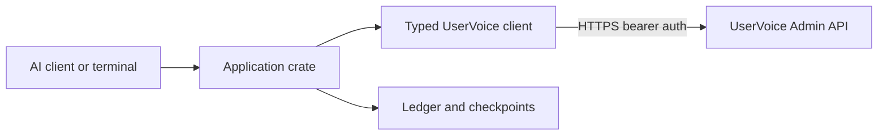

# rusty-user-voice

A local Rust MCP stdio server and CLI for working with UserVoice feedback from AI assistants.

It ships two binaries. The MCP server communicates over stdio and opens no inbound HTTP service. Use the CLI or MCP tools to search ideas, collect snapshots, preview and apply changes, and record feedback with its source. Rate limiting, retries, and an audit ledger are built in.

[](.github/workflows/ci.yml)
[](https://doc.rust-lang.org/edition-guide/rust-2024/)
[](https://modelcontextprotocol.io/)
[](LICENSE-MIT)

---

## What it does

| Problem | How the project handles it |
|---------|----------------------------|
| An AI assistant needs UserVoice access | The MCP server keeps the token out of assistant messages and logs. It sends the token to UserVoice over HTTPS. |
| Triage takes too long | `collect` streams NDJSON for a time window and resumes from named checkpoints. |
| Changes need review | Every write uses preview and apply, with a `change_id` TTL, optimistic `updated_at` checks, idempotency keys, and an on-disk ledger. |
| Context is spread across UserVoice | `workspace_context` loads forums, categories, statuses, and labels. `get_idea_context` loads an idea with comments, notes, feedback, and supporters. |
| Changes need a record | The local ledger stores preview records, idempotency receipts, and collection checkpoints. It stores no secrets or PII. |
| UserVoice rate limits requests | The client limits in-flight requests, backs off using `Retry-After`, and writes structured traces to stderr. |

---

## Quick start

Requirements: Rust stable and UserVoice Admin API access.

From a local checkout, install both binaries:

```bash
cargo install --path crates/rusty_user_voice --bins --locked
```

Configure the process environment and verify access:

```bash
export USERVOICE_BASE_URL="https://your-tenant.uservoice.com"
export USERVOICE_API_KEY="<admin-bearer-token>"
uservoice-cli workspace --include-catalog
```

See [MCP server](#mcp-server) for client configuration. [Configuration](#configuration) lists all available settings.

---

## Architecture

This is a two-crate Rust workspace that uses edition 2024. The package metadata declares compatibility with Rust 1.85 and later.

| Crate | Responsibility |
|-------|----------------|
| [`uservoice_client`](crates/uservoice_client) | Typed HTTP adapter: auth, models, pagination, rate limits, retries. Zero workflow logic. |
| [`rusty_user_voice`](crates/rusty_user_voice) | Application layer: CLI (`uservoice-cli`), MCP server (`uservoice-mcp`), config resolution, checkpoint store, change ledger, domain workflows. |

The binaries live in `crates/rusty_user_voice`:

- `src/main.rs` → `uservoice-mcp` (MCP stdio server)
- `src/bin/cli.rs` → `uservoice-cli` (terminal workflows)

See [`CONTEXT.md`](CONTEXT.md) for ubiquitous language and [`docs/adr/`](docs/adr/) for architectural decisions.



---

## Security

- **Credentials**: `USERVOICE_API_KEY` comes from the process environment or `config.yaml`, never from a CLI flag. The client sends it to UserVoice as an HTTPS bearer token. It never logs the token or puts it in MCP output or local state. `Debug` and `Display` output it as `[REDACTED]`. There is no `--api-key` flag by design; automation passes the key via `USERVOICE_API_KEY` env or `--api-key-stdin` (pipe), and `login` never prints it.
- **Network**: The client uses HTTPS for `https://<tenant>.uservoice.com/api/v2/admin/...`. It allows HTTP only for loopback hosts in tests.
- **Writes**: Every write uses preview and apply. Preview returns an opaque `change_id` with a 15-minute TTL. Apply requires `confirmation="apply"` and a caller-generated `idempotency_key`. The ledger prevents a `change_id` from being applied twice.
- **Local state**: `USERVOICE_STATE_DIR` contains preview records, idempotency hashes, and collection cursors. It contains no tokens, feedback bodies, or email addresses.
- **File permissions**: Set local credential files such as `.env` to mode `0600`. Never commit `config.yaml`, which can contain secrets. See `.env.example` for the variable list.

---

## Configuration

The application resolves settings in this order: **CLI flags, environment variables, `config.yaml`, then defaults**. Prefer `uservoice-cli login` over hand-editing secrets.

It checks these config file locations in order:
1. `config.yaml` next to the binary
2. `~/.config/rusty-user-voice/config.yaml` (written by `uservoice-cli login`)

On macOS and Linux:

```bash
mkdir -p "$HOME/.config/rusty-user-voice"
cp config.example.yaml "$HOME/.config/rusty-user-voice/config.yaml"
# edit with your values
```

### First run (recommended)

```sh
uservoice-cli login
# prompts for base URL + API key (hidden input), validates via users/current,
# saves to ~/.config/rusty-user-voice/config.yaml (mode 0600).
uservoice-cli workspace --include-catalog
```

### For AI agents (non-interactive)

```sh
echo "$USERVOICE_API_KEY" | uservoice-cli --output json login --base-url URL --api-key-stdin --force
# secret hygiene: there is NO --api-key flag (argv leaks via ps/history).
# prefer USERVOICE_API_KEY env or --api-key-stdin. exit codes: 0 ok, 2 usage,
# 3 needs --force, 1 other; in machine mode errors go to stderr as
# {"ok":false,"reason","detail","hint"} with stable reason (missing_value,
# confirmation_required, validation_failed, not_logged_in, io_error).
# stdout stays empty on failure.
uservoice-cli --output json workspace --include-catalog
```

### Environment variables & config keys

| Setting | CLI flag | Env var | Config key | Type | Default | Range / values |
|---------|----------|----------|-------------|------|---------|----------------|
| Base URL | `--base-url` | `USERVOICE_BASE_URL` | `uservoice_base_url` | string | **required** | `https://<tenant>.uservoice.com` |
| API token | not available (use `login`) | `USERVOICE_API_KEY` | `uservoice_api_key` | string | **required** | Bearer token from Admin Console |
| State dir | `--state-dir` | `USERVOICE_STATE_DIR` | `uservoice_state_dir` | path | platform app data dir¹ | writable directory |
| Max in-flight | `--max-in-flight` | `USERVOICE_MAX_IN_FLIGHT` | `uservoice_max_in_flight` | u32 | `2` | `1` to `8` |
| Default output | `--output` | `USERVOICE_DEFAULT_OUTPUT` | `default_output` | enum | `human` | `human \| json \| ndjson` |
| CA certificate | not available | not available | `ca_cert` | path | *(none)* | PEM/DER file for on-prem TLS |
| Log level | not available | `USERVOICE_LOG_LEVEL` | `log_level` | enum | `warn` | `error \| warn \| info \| debug \| trace` (`RUST_LOG` overrides) |

¹ Platform defaults: `$XDG_STATE_HOME/rusty-user-voice` on Linux, `~/Library/Application Support/rusty-user-voice` on macOS, and `%LOCALAPPDATA%\rusty-user-voice` on Windows.

### Example `config.yaml`

```yaml
# Required. Prefer USERVOICE_API_KEY in the process environment.
# Keep committed examples empty; never commit a real token.
uservoice_api_key: ""
uservoice_base_url: "https://acme.uservoice.com"

# Optional
uservoice_state_dir: "/home/pm/.local/state/rusty-user-voice"
uservoice_max_in_flight: 4
default_output: "json"
ca_cert: "/etc/ssl/certs/corp-root-ca.pem"
log_level: "info"
```

---

## CLI workflows

The CLI binary is `uservoice-cli`. You can also run it with `cargo run --bin uservoice-cli --`.

### Global flags
```bash
uservoice-cli --base-url https://acme.uservoice.com \
              --state-dir ~/.local/state/uservoice \
              --max-in-flight 4 \
              --output json \
              <command>
```

### Discover the workspace and search ideas
```bash
# Full workspace context (principal + forums + categories + statuses + labels + rate limit)
uservoice-cli workspace --include-catalog

# Search ideas (page-based)
uservoice-cli ideas search --query export --per-page 100 --page 1

# Search with cursor pagination (for scripting)
uservoice-cli ideas search --query export --cursor "eyJ..." --per-page 100

# Auto-paginate everything → NDJSON stream (cursor hints to stderr)
uservoice-cli ideas search --query export --all

# Get full idea context (comments, notes, feedback, supporters, status history)
uservoice-cli ideas get 101 --detail-level full --include-supporters
```

### Collect a time window
```bash
# Named checkpoint auto-resumes on re-run with same --checkpoint-name
uservoice-cli --output ndjson ideas collect \
  --updated-after 2025-01-01T00:00:00Z \
  --updated-before 2026-07-24T00:00:00Z \
  --checkpoint-name weekly-triage

# Filter by forum + query
uservoice-cli --output ndjson ideas collect \
  --updated-after 2025-01-01T00:00:00Z \
  --forum-ids 11 \
  --query osmp
```

> **Pagination and cursors:** See [`skills/uservoice-pm/references/pagination.md`](skills/uservoice-pm/references/pagination.md) for page and cursor behavior, `--all` streaming, and checkpoints.

### Preview and apply changes
```bash
# 1. Preview (dry-run) — returns change_id
uservoice-cli --output json ideas update 101 \
  --mode preview \
  --title "Export roadmap as CSV" \
  --add-label-ids 14

# 2. Apply — must repeat fields, include change_id, confirmation="apply", unique idempotency_key
uservoice-cli --output json ideas update 101 \
  --mode apply \
  --title "Export roadmap as CSV" \
  --add-label-ids 14 \
  --change-id <uuid-from-preview> \
  --confirmation apply \
  --idempotency-key pm-run-20260724-idea-101
```

### Publish status updates
```bash
uservoice-cli --output json ideas publish 101 \
  --mode preview \
  --status-id 5 \
  --message "Shipping CSV export in v2.4"

uservoice-cli --output json ideas publish 101 \
  --mode apply \
  --status-id 5 \
  --message "Shipping CSV export in v2.4" \
  --change-id <uuid-from-preview> \
  --confirmation apply \
  --idempotency-key pm-publish-20260724-idea-101
```

### Record feedback with its source
```bash
uservoice-cli --output json feedback record \
  --body "Customer needs a downloadable roadmap." \
  --channel api \
  --idea-id 101 \
  --source-url https://crm.example.invalid/cases/42 \
  --source-guid case-42 \
  --idempotency-key feedback-case-42
```

Available feedback channels: `admin`, `api`, `bookmarklet`, `gainsight`, `import`, `portal`, `roadmap`, `slack`, and `zendesk`. See [`cli.rs:265-292`](crates/rusty_user_voice/src/cli.rs#L265-L292).

---

## MCP server

The `uservoice-mcp` binary uses stdio transport only.

### Client configuration
```json
{
  "mcpServers": {
    "uservoice": {
      "command": "/usr/local/bin/uservoice-mcp",
      "env": {
        "USERVOICE_BASE_URL": "https://acme.uservoice.com",
        "USERVOICE_STATE_DIR": "/Users/pm/.local/state/rusty-user-voice"
      }
    }
  }
}
```

> Set `USERVOICE_API_KEY` in the process environment that starts the MCP server. The key may also come from `config.yaml`, but never put it in the MCP JSON configuration.

### Available tools

| Tool | Purpose | Read-only? |
|------|---------|------------|
| `uservoice_workspace_context` | Verify access; load principal + full taxonomy (forums, categories, statuses, labels) + rate-limit envelope. **Start here.** | ✅ |
| `uservoice_search_ideas` | Find ideas by text, update window, taxonomy IDs, state, sort. Returns compact summaries + continuation. | ✅ |
| `uservoice_get_idea_context` | Load one idea by `idea_id`. `detail_level=full` adds comments, notes, status history, feedback, supporters. | ✅ |
| `uservoice_collect_ideas` | Resumable page of ideas updated in a bounded time window. Full detail capped at 10/page; summary at 100. Caller must persist continuation. | ✅ |
| `uservoice_update_idea` | Safe mutation: `mode=preview` → returns `change_id`; `mode=apply` consumes `change_id` + `confirmation="apply"` + `idempotency_key`. | ❌ |
| `uservoice_publish_idea_update` | Public status update to supporters. Same preview/apply flow. | ❌ |
| `uservoice_record_feedback` | Import external feedback (support, Slack, email) with provenance (`channel`, `source_url`, `source_guid`). Idempotent via `idempotency_key`. | ❌ |

A typical read workflow is `workspace_context` → `search_ideas` → `get_idea_context`. Use preview and apply for mutation tools.

---

## Verification

### Without credentials
```bash
# Formatting
cargo fmt --all -- --check

# Linting (deny warnings)
cargo clippy --workspace --all-targets --all-features --locked -- -D warnings

# Unit + integration tests (fixtures only)
# Config tests mutate process-wide environment variables, so run tests serially.
cargo test --workspace --all-features --locked --no-fail-fast -- --test-threads=1

# Documentation
cargo doc --workspace --all-features --no-deps --locked
```

### Live smoke test

These ignored tests call a real UserVoice tenant. Run them only with a valid bearer token in the process environment. The project does not commit credential files. On macOS, you can source a local env file:

```bash
test "$(stat -f '%Lp' .env)" = "600"   # macOS
set -a; source .env; set +a
cargo test --workspace --all-features --locked -- --ignored --test-threads=1
```

On Linux use `stat -c '%a' .env` instead of `stat -f '%Lp' .env`.

---

## Support and contributing

Use the repository's GitHub Issues tab for bug reports and feature requests. Include the command or MCP call, operating system, Rust toolchain, and a redacted error log. Do not include API tokens or customer data.

Before opening a pull request:

1. Keep the change focused and update the relevant documentation.
2. Add or update fixture-based tests when behavior changes.
3. Run the complete [verification](#without-credentials) suite.
4. Describe any security or migration impact.

---

## References

| Topic | File |
|-------|------|
| Ubiquitous language / domain terms | [`CONTEXT.md`](CONTEXT.md) |
| Architecture Decision Records | [`docs/adr/`](docs/adr/) |
| Security model details | [`docs/security.md`](docs/security.md) |
| UserVoice API surface map | [`docs/uservoice-api-map.md`](docs/uservoice-api-map.md) |
| Pagination, cursors, checkpoints | [`skills/uservoice-pm/references/pagination.md`](skills/uservoice-pm/references/pagination.md) |
| Idea triage workflow | [`skills/uservoice-pm/references/triage-ideas.md`](skills/uservoice-pm/references/triage-ideas.md) |
| Close-the-loop feedback workflow | [`skills/uservoice-pm/references/close-feedback-loop.md`](skills/uservoice-pm/references/close-feedback-loop.md) |
| CLI argument definitions | [`crates/rusty_user_voice/src/cli.rs`](crates/rusty_user_voice/src/cli.rs) |
| Config loading & precedence | [`crates/rusty_user_voice/src/config.rs`](crates/rusty_user_voice/src/config.rs) |
| MCP tool definitions | [`crates/rusty_user_voice/src/mcp.rs`](crates/rusty_user_voice/src/mcp.rs) |
| Example config file | [`config.example.yaml`](config.example.yaml) |

---

## License

[MIT](LICENSE-MIT)
